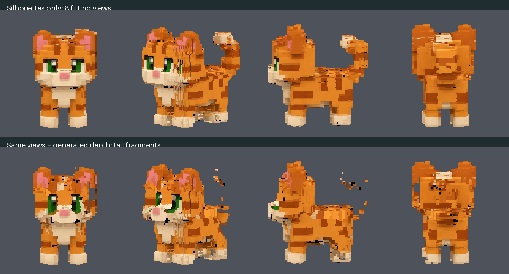
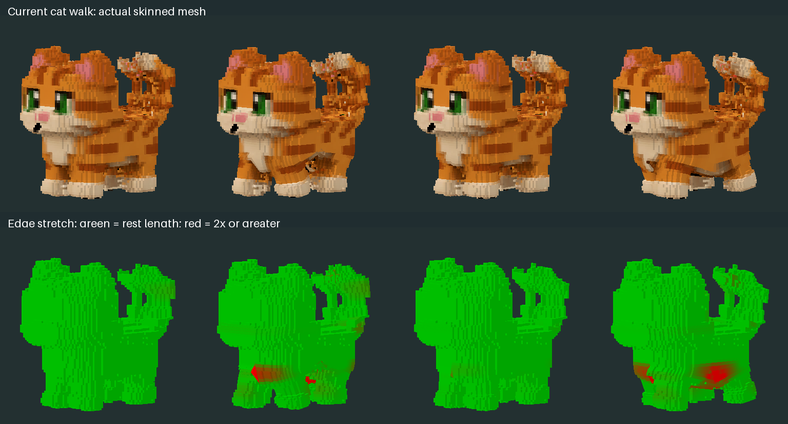

# Conditioned depth reconstruction trial — 2026-11-24

**Decision: keep prompt-generated depth experimental.** Depth is useful when
geometrically correct, but these generated maps made reconstruction worse.
Neither the canonical assets nor the default reconstruction path was replaced.
The cat's present rig is export-valid, but is not ready for polished animation.

## What was tested

Three actual image-generation calls were conditioned on project assets, with
transparent output requested: a grayscale conversion of the original 16-view
cat sheet; a false-color conversion conditioned only on eight alternating cat
views; and a false-color conversion of exact renders of the existing cat and
adventurer meshes. The last case supplies known cameras and ground-truth depth
for evaluation, without giving that depth to the generator.

The generated PNGs are preserved in `source/`. `prompts.json` contains the exact
submitted prompts; `acquisition.json` records inputs, settings and file hashes.
The tool did not expose a model version or seed. These are generated estimates,
not measured depth or maps produced by a specialized depth-estimation network.

The prompts specify linear signed depth toward the camera from -0.6 to +0.6
character heights. Grayscale uses black-to-white; false color uses blue, cyan,
green, yellow and red. Hue decoding is invariant to brightness changes, which
gives the colored maps a chance despite residual lighting. Each generated view
receives one bounding-box affine registration to its source silhouette. No
per-part or nonrigid registration is used. Valid depth pixels are inset two
pixels from overlapping masks, and low-saturation hue pixels are excluded.

The trial carves free space in front of estimated surfaces, starting from the
silhouette volume. The fixed primary settings allow 0.08 height units of depth
error and require agreement from at least two depth views before removing a
voxel. RGB color observations are the same for both reconstruction variants.
The original source cameras are retained for evaluation.

A bounded yaw search tests -10, -5, 0, +5 and +10 degrees around each annotated
angle using fitting silhouettes only, holding scale and translation fixed.
It recovers a deliberately perturbed 5-degree camera in the numerical control.
It chooses zero adjustment for all eight fitting views in the held-out cat
trial. This is a limited yaw experiment, not a full camera-calibration solver.

## Reconstruction results

| Experiment | Metric | Silhouettes only | Generated depth | Exact depth |
|---|---|---:|---:|---:|
| Cat source: 8 fit / 8 withheld views | Mean withheld 2D silhouette IoU | 87.82% | 81.72% | Not available |
| Existing cat mesh: 4 known cameras | 3D voxel IoU against original mesh | 78.24% | 48.82% | 81.37% |
| Existing adventurer mesh: 4 known cameras | 3D voxel IoU against original mesh | 78.31% | 58.35% | 79.03% |
| Synthetic solid with hidden front recess | 3D voxel IoU against known volume | 88.35% | Not generated | 97.99% |

The withheld cat views were absent from the eight-view generator conditioning
sheet and from fitting, yaw selection and color fusion. They are used only for
evaluation. The existing-mesh control uses the same 0.08-height/two-view carving settings
for generated and exact depth, and evaluates recovery of those imperfect
meshes; it does not claim they are artistically correct cats or people.



The depth-assisted cat loses much of its tail and develops 36 voxel components,
versus one for the silhouette model. The main component contains 99.6% of its
remaining voxels; small floating pieces are not the only problem. The missing
tail and altered face remain visible on the main component. Experimental
builds are under `experiments/depth-trial/`, outside the runtime asset paths.

A fixed nine-setting sensitivity sweep varies depth tolerance from 0.04 to
0.16 heights and required views from one to four. None beats the 87.82%
baseline: results range from 60.31% to 86.99%. The most conservative setting
mostly preserves the silhouette volume, rather than demonstrating better
geometry. The sweep is reported in full, not used to select a shipping model.

The preliminary grayscale/full-sheet diagnostic is worse still: same-view
overlap falls from 90.41% to 36.92%. It has no withheld views and is not an
independent validation. Its baseline differs slightly from the canonical
report because this trial evaluates pixel-center triangle z-buffer masks
rather than the older polygon-fill rasterizer.

## Depth accuracy and calibration

On the known-render control, registered silhouettes overlap by 95.4–98.1%, so
the failure persists even when the generator keeps the image outline close.
Raw depth RMSE averages 0.305 character heights for the cat and 0.240 for the
adventurer. These errors exceed the primary 0.08-height carving tolerance.

For a generous diagnostic, fit a separate depth scale and offset to known
ground truth using alternating 24-pixel blocks, then evaluate on the other
blocks. This uses information unavailable when reconstructing a new character;
it is an upper-bound calibration diagnostic, not the proposed production method.

| Character | Raw RMSE | Affine-calibrated RMSE | Constant-depth RMSE |
|---|---:|---:|---:|
| Cat | 0.305 | 0.127 | 0.134 |
| Adventurer | 0.240 | 0.072 | 0.074 |

Numbers are means of per-view RMSE, in character heights. Even with this
ground-truth-assisted calibration, the maps offer little detail beyond a
constant-depth estimate. Three of eight fitted scales are negative, indicating
that the expected near/far ordering is weak or reversed in those views.

Inspection shows residual material boundaries, lighting-like gradients on
flat voxel faces, softened geometry and inconsistent depth across rotations.
Depth-colored appearance is therefore insufficient evidence of a useful
geometric measurement. Known exact depth improves both real-model controls,
so this result does not reject depth-assisted reconstruction itself.

## Is the current cat rig good?

It has valid bind matrices, normalized weights and playable clips. That earlier
audit answers whether the GLB is internally consistent; it does not establish
good anatomical separation or planted paws.

The present tail has two bones and broad position-based weight gates. It
supports a small sway, not controlled articulation along the curl. Tail
weights extend into a broad upper-rump region. The silhouette volume also
touches both Z grid limits (190 and 180 occupied boundary voxels), which flags
grid truncation in addition to inconsistent source views.

The expanded walk assessment samples the actual exported skin palettes. At the
runtime's 0.45 scale and 2.2 units/second reference speed, each paw centroid
drifts 0.647–0.721 world units during its expected stance segment, compared to
a rest paw length of 0.0984 units: about 6.6–7.3 paw lengths. Stance is inferred
from the procedural gait phase, not measured physical contact. The clip has no
foot locking or contact solver, and its stride does not match runtime travel.

The 99th percentile sampled mesh-edge length ratio is 1.256, and the maximum
is 8.65. These are face-edge samples, including material/face duplicates, not
independent anatomical measurements. Large strain appears at leg/body seams.



The appropriate next rig work is to separate/refit limb and rump weights,
articulate the tail along its actual centerline, and match stride/contact to
travel speed after the geometry is corrected. More bones alone will not fix
the reconstructed tail or fused limb regions. Those changes are not smuggled
into this depth-method trial.

## Reproduce

Run from `Adventure Town/` with the existing Python pipeline requirements
installed. No new Python or Node dependencies are introduced.

```sh
python tools/asset_pipeline/test_depth_trial.py
python tools/asset_pipeline/depth_trial.py characters/cat docs/depth-trial-20261124/source/cat-depth-color.png --encoding hue --rows 2 --cols 4 --views 0 2 4 6 8 10 12 14 --sweep --out experiments/depth-trial/color
python tools/asset_pipeline/depth_trial.py characters/cat docs/depth-trial-20261124/source/cat-depth-gray.png --encoding gray --rows 4 --cols 4 --views 0 1 2 3 4 5 6 7 8 9 10 11 12 13 14 15 --out experiments/depth-trial/gray
python tools/asset_pipeline/depth_control.py prepare characters/cat characters/adventurer --out experiments/depth-trial/control
python tools/asset_pipeline/depth_control.py evaluate experiments/depth-trial/control docs/depth-trial-20261124/source/control-depth-color.png --out experiments/depth-trial/control-evaluation
python tools/asset_pipeline/assess_quadruped.py characters/cat/generated --scale .45 --speed 2.2 --out experiments/depth-trial/rig-assessment.json
python tools/asset_pipeline/build_character.py characters/adventurer --out experiments/depth-trial/adventurer-regression
npm test
npm run build
```

The numerical controls, canonical adventurer rebuild/audit, runtime test and
production build pass. Committed character sources, generated runtime assets,
gameplay and the standard compiler are unchanged. Browser rendering was not
retested; all new visual comparisons come from the actual offline geometry.

## Adoption gate and research context

Future depth inputs should preserve silhouette registration, maintain a common
depth scale and camera convention, improve withheld-view results, retain thin
connected parts, and pass the existing character regression and motion review.
Keep them out of the default manifest/build path until those conditions pass.
The trial scripts are reusable measurement tools, not an approved acquisition
step or a claim that arbitrary AI-generated depth can be fused safely.

[MVDD](https://mvdepth.github.io/) explicitly uses multiview attention and depth
fusion to enforce consistency. [MVGD](https://arxiv.org/abs/2501.18804) conditions
joint image/depth generation on camera geometry. They support testing
geometry-aware depth inference next; neither paper validates this general
image-generation tool as a calibrated depth estimator.

Raw numerical results: [withheld cat trial](cat-held-out.json),
[grayscale diagnostic](cat-gray-diagnostic.json),
[known-geometry control](known-geometry.json), and
[rig assessment](rig-assessment.json).
