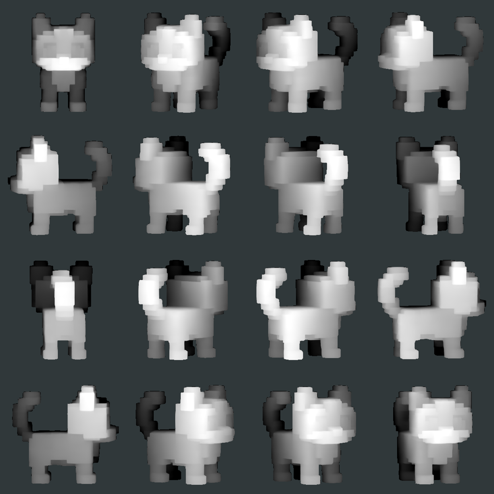
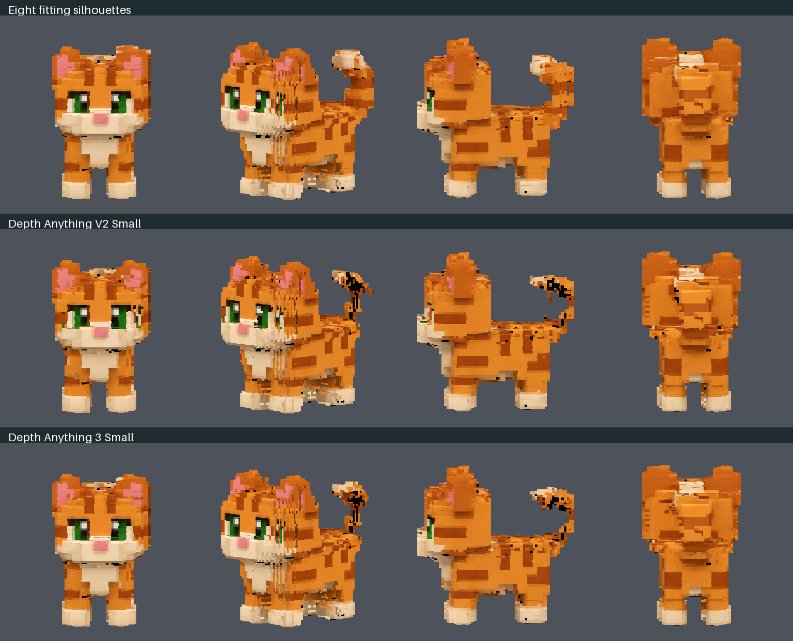

# Monocular and multiview depth follow-up — 2026-11-24

**Decision: useful signal, insufficient reconstruction robustness for the basic
pipeline.** Actual depth estimators improve the known-geometry cat control, but
the gain does not transfer consistently to the source turntable. The cat's tail
still becomes thin and develops gaps. All builds remain experimental; source
art, runtime models and the standard compiler are unchanged.

## Methods

This follows the [generated-depth trial](../depth-trial-20261124/README.md).
Both checkpoints were downloaded and actually run on CPU: the official
[Depth Anything V2 Small](https://huggingface.co/depth-anything/Depth-Anything-V2-Small-hf)
through Transformers, and [DA3 Small](https://huggingface.co/depth-anything/DA3-SMALL)
through its upstream network. Raw floating-point predictions are resized back
to each original view. Alpha is kept separately; the estimator receives RGB
composited over neutral gray. No per-frame display normalization is used as
geometry data. Previews below normalize for display only.



V2 inference was roughly 0.45–0.94 seconds per neutral-background source view
after initialization, using four CPU threads at its default 518-pixel input.
DA3 processed eight fitting views together in about 4.2–6.1 seconds at 378 pixels
in float32. Some jobs overlapped, so these are observed latencies rather than a
controlled speed comparison. Neither uses a GPU. Model revisions, checkpoint
hashes, source hashes and timings are in the result records.

Both produce relative quantities. The primary conversion to height-normalized
camera depth fits a **positive affine scale and offset to the fitting visual
hull**, using a Huber loss. It never uses true depth, withheld views, or the
committed full-view volume for source reconstruction calibration. A second
variant fits thinner hull rays. DA3 also tests one scale/offset shared across
all fitting views. Ground-truth-assisted affine fits are reported only as an
oracle diagnostic of the available signal, not as a deployable calibration.

Depth fusion removes free-space voxels supported by at least two views, with a
primary tolerance of 0.04 character heights. Sensitivity results cover 0.02,
0.04 and 0.08 heights and one, two or four supporting views. These exploratory
sweeps are reported in full; their best withheld score is not promoted as a
validated shipping setting.

## Known-geometry controls

Four exact rendered views of each existing model provide independently known
depth and voxel occupancy for evaluation. The visible RGB/alpha masks are the
inputs. Calibration uses only their fitting silhouette hull. The baseline
includes the character's normal rig-configured arm gap, so the adventurer
baseline differs slightly from the preceding trial.

| 3D voxel overlap | Silhouettes | V2 Small | DA3 Small | DA3 with camera conditioning |
|---|---:|---:|---:|---:|
| Cat | 78.24% | 79.86% | 80.03% | 79.50% |
| Adventurer | 78.65% | 78.76% | 78.93% | 78.79% |

These are the fixed primary settings, not the best sweep values. A constant
depth plane per view, derived from the hull alone, scores 78.26%/78.65%.
The measured cat gain therefore exceeds that simple non-neural ablation.
Thin-ray calibration reaches 80.98% for V2 on the cat and 79.73% for DA3 on the
adventurer, but performs worse on some real source-view tests below.

## Source turntables: withheld views

Only alternating fitting views enter a DA3 batch. Each V2 image is inferred
independently, and only fitting maps are used for calibration and carving.
The other eight source views are used only for evaluation. Both variants use
identical fitting RGB observations for surface color.

| Mean withheld 2D overlap, even views fit | Silhouettes | V2 Small | DA3 Small | DA3 with camera conditioning |
|---|---:|---:|---:|---:|
| Cat | 87.82% | 86.45% | 86.82% | 85.49% |
| Adventurer | 91.16% | 91.19% | 91.17% | 91.15% |

V2 was also tested with the split reversed. For the cat, the reverse split
improves from 82.62% to 83.56%, illustrating the sensitivity to which source
views establish the hull. Across both splits, its cat average changes from
85.22% to 85.00%; the adventurer average changes from 90.38% to 90.53%.
DA3's reverse split was not tested; it already failed the first cat split.



The DA3 primary cat has eight voxel components rather than one, though its
largest component retains 99.97% of the remaining voxels: most detached chips
are tiny. The more consequential visual problem is the over-thinned tail on
the main component. Counting components alone would overstate fragmentation;
looking only at the global overlap would miss the damaged thin structure.

A darker RGB background was tested with V2. Cat overlap is 86.44% rather than
86.45%, so changing the neutral backdrop does not rescue this configuration.
Shared DA3 depth calibration and thinner-ray anchors also fail to provide a
consistent source-character win. The partial improvement on exact model
renders is not proof of better unseen geometry in the generated source art.

## Camera experiments

DA3 was tested both freely and conditioned on our known/annotated rotations.
Because the compiler is orthographic and DA3 consumes perspective cameras,
conditioning uses an explicitly approximate long-lens camera at six character
heights, with focal lengths matching the image scale. Crop offsets are
expressed as translation with centered principal points, as required by DA3's
camera token representation. This is not exact orthographic support.

On the known-render control, non-reference rotation errors average 10.38°
without camera conditioning and 2.00° with it, with maxima of 19.12° and 2.91°.
The conditioned case receives camera information, so it is not evidence of
equivalent pose recovery from RGB alone. Improved pose agreement does not
produce a correspondingly robust depth-fusion gain.

For a separate source test, inferred relative rotations refine only fitting
camera yaw/elevation. The first fitting annotation anchors the gauge; yaw
updates are limited to ±15° and elevation to 0–10°. Withheld cameras stay fixed.
This changes the camera-only adventurer score from 91.16% to 91.75%, while the
cat falls from 87.82% to 82.17%. Adding depth gives 91.70% and 81.86% respectively.
The adventurer's improvement is primarily a camera change, not a depth gain.
Unrestricted inferred source yaw sometimes differs by over 30° from our
annotations; neither is calibrated ground truth for generated views.

## Reproduce

The research dependencies are isolated from the basic compiler. On Linux CPU,
create a separate virtual environment and install the existing asset-pipeline
requirements plus the packages below. The versions shown are the ones tested.
No learned weights or third-party source are committed to this repository.

```sh
python -m pip install torch==2.15.0 --index-url https://download.pytorch.org/whl/cpu
python -m pip install transformers==5.24.1 safetensors==0.8.0 omegaconf==2.4.0 einops==0.8.2 addict==2.4.0
hf download depth-anything/Depth-Anything-V2-Small-hf config.json preprocessor_config.json model.safetensors --revision 5426e4f0f36572d16453bbda7a8389317b1bef99 --local-dir experiments/models/v2-small
hf download depth-anything/DA3-SMALL config.json model.safetensors --revision e08cab65ca0ec38e7826075418411ab90cab4da3 --local-dir experiments/models/da3-small
git clone https://github.com/ByteDance-Seed/Depth-Anything-3 experiments/da3
git -C experiments/da3 checkout 3d835ec1a5802d64a8b8b15f817a1ab54809bfe4
```

Run from `Adventure Town/`. Prepare controls and infer each view independently:

```sh
python tools/asset_pipeline/depth_control.py prepare characters/cat characters/adventurer --out experiments/mono/control
python tools/asset_pipeline/estimate_depth.py experiments/mono/control/control-render.png --rows 2 --cols 4 --model experiments/models/v2-small --out experiments/mono/control-v2
python tools/asset_pipeline/estimate_depth.py characters/cat/source/turntable.png --rows 4 --cols 4 --model experiments/models/v2-small --out experiments/mono/cat-v2
python tools/asset_pipeline/estimate_depth.py characters/adventurer/source/turntable.gif --rows 4 --cols 4 --model experiments/models/v2-small --out experiments/mono/adventurer-v2
python tools/asset_pipeline/monocular_trial.py experiments/mono/control experiments/mono/control-v2/predictions.npz --control --out experiments/mono/control-evaluation
python tools/asset_pipeline/monocular_trial.py characters/cat experiments/mono/cat-v2/predictions.npz --out experiments/mono/cat-even
python tools/asset_pipeline/monocular_trial.py characters/cat experiments/mono/cat-v2/predictions.npz --parity 1 --out experiments/mono/cat-odd
```

For DA3, put its `src/` on `PYTHONPATH`. The underlying upstream network is
called directly in float32 so unused web/export applications and GPU-specific
extensions are unnecessary. Safetensors loads strictly, including resolution
of the checkpoint's shared LayerNorm aliases; no active weights are discarded.

```sh
PYTHONPATH=experiments/da3/src python tools/asset_pipeline/estimate_multiview_depth.py characters/cat/source/turntable.png --rows 4 --cols 4 --views 0 2 4 6 8 10 12 14 --group-size 8 --model experiments/models/da3-small --out experiments/mono/cat-da3
python tools/asset_pipeline/monocular_trial.py characters/cat experiments/mono/cat-da3/predictions.npz --shared --out experiments/mono/cat-da3-evaluation
python tools/asset_pipeline/monocular_trial.py characters/cat experiments/mono/cat-da3/predictions.npz --pose-refine --shared --out experiments/mono/cat-da3-pose-evaluation
python tools/asset_pipeline/test_monocular_trial.py
python tools/asset_pipeline/test_depth_trial.py
```

Camera-conditioning accepts a JSON list of the same `angle`, `elevation`,
`cx`, `floor` and `scale` dictionaries used by the compiler. Complete lists,
indexed by decoded source view, are preserved in [cameras/](cameras/); for
example, add `--cameras docs/monocular-depth-20261124/cameras/cat.json` to the
multiview estimator. `fitting_cameras` in each result records just the fitting
subset. All angle units are radians. For a control sheet, use `--group-size 4` so different characters
never enter the same multiview group. Default source evaluation uses the
existing 64-voxel grid and per-character arm-gap settings.

## Verification and adoption

Numerical controls cover masked affine calibration, shared depth units,
withheld-camera isolation, original depth decoding, exact-depth recess recovery
and a known yaw perturbation. They pass, as do the canonical adventurer rebuild
and audit, `npm test`, `npm run build` and `git diff --check`. The adventurer's
occupancy/color cache, reports, rig preview and three motion GIFs reproduce
the committed baseline byte-for-byte; [regression details](regression.json)
include the unchanged source hash. No browser-rendering claim is made for
these offline experiments.

The estimator is now a reproducible research step. It is **not** enabled in
`build_character.py`, the character manifest, or the runtime. Before adoption,
the combined calibration/fusion stage needs a repeatable geometry gain without
thin-part damage or material withheld-view regressions. These tests establish
that useful learned depth is available here; they do not establish that our
current orthographic multiview fusion uses it well enough.

Complete [result records](results/) include both V2 split directions, the
background check, DA3 pose-conditioned/shared-depth variants, sensitivity
sweeps, camera-only comparisons and inference provenance. Experimental float
caches and mesh builds remain in `experiments/monocular-depth/` and can be
regenerated with the pinned checkpoints.
