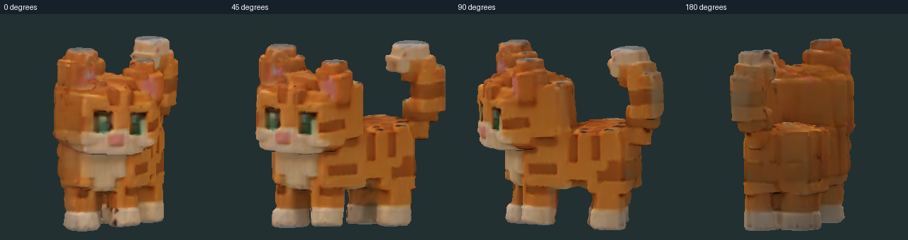
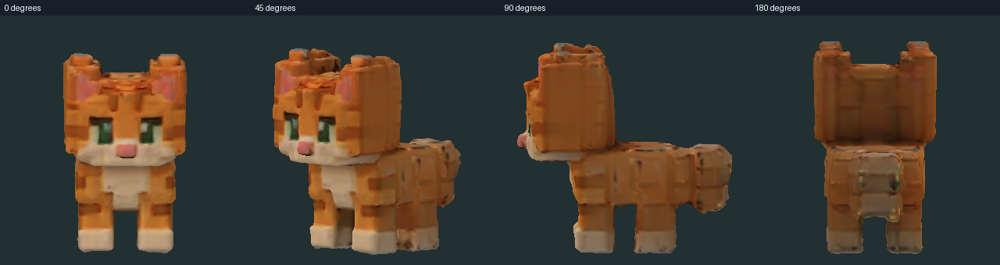
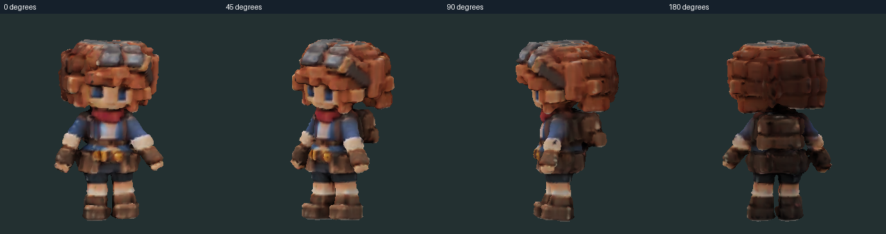
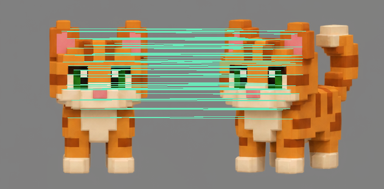
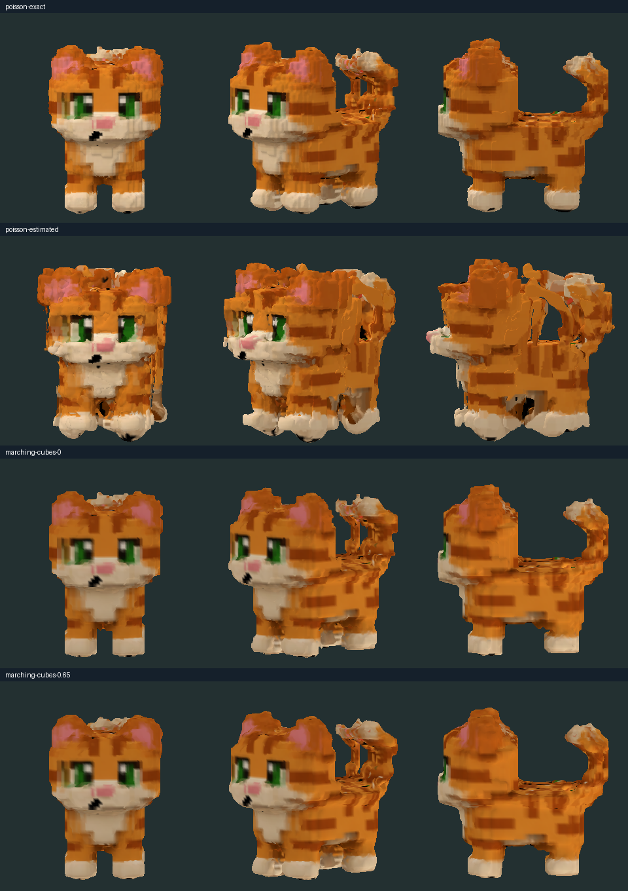
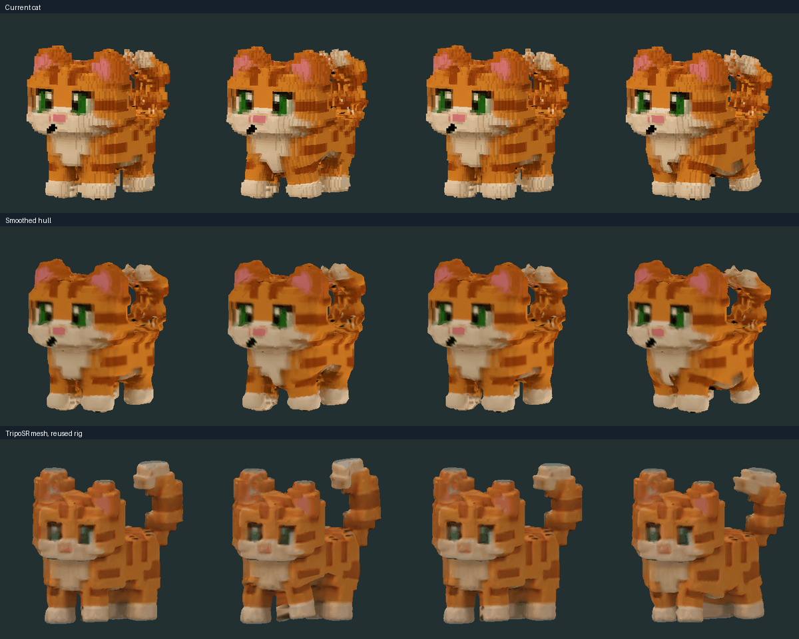

# Reconstruction library trials — 2026-11-24

**TripoSR is a promising alternate mesh generator for this project.** Its
oblique-view cat has a substantially cleaner raised tail than our visual hull.
LightGlue and bounded bundle adjustment also provide useful correspondence and
camera diagnostics. Open3D works well with consistent depths, but does not
repair inconsistent estimates. None of these trials establishes a robust,
automatic image-to-rigged-game-character pipeline yet.

All inference and reconstruction below actually ran on CPU. No production
character, source image, runtime, or default compiler dependency was replaced.
Unapproved meshes and float caches remain in `experiments/reconstruction-options/`.
This directory preserves measurements and real mesh renders, not generated
illustrations of hypothetical results.

## Direct image-to-mesh: TripoSR

We ran the [official TripoSR implementation](https://github.com/VAST-AI-Research/TripoSR)
and checkpoint, with its normal foreground preparation, gray background,
8,192-point extraction chunks, density threshold 25 and 128³ marching cubes.
The existing alpha channel supplies the foreground; no new background-removal
model or source-image edit was needed. Each inference uses **one image**,
not the whole turntable.

| Input | Scene inference | Peak process RSS | Raw mesh | Cleaned mesh | Other-view silhouette IoU |
| --- | ---: | ---: | --- | --- | ---: |
| Cat, view 2 / 45° | 15.1 s | 3,984 MiB | 4 components, open | 1 component, watertight | 75.71% |
| Cat, view 0 / front | 12.9 s | 3,698 MiB | 2 components, open | 1 component, still open | 74.92% |
| Adventurer, view 2 / 36° | 12.4 s | 3,698 MiB | 5 components, open | 1 component, watertight | 81.38% |

Model loading takes another 17–19 seconds; mesh extraction takes about 2.4
seconds. These timings exclude Python imports. Peak RSS covers the Python
process, not every process on the host. The model and input provenance is in
[provenance.json](provenance.json).

The oblique cat preserves four legs and a much more coherent tail:



The front-only input hides much of the tail and body depth. Its result invents
a shorter, horizontal tail. A plausible frontal render is not sufficient:



The adventurer is recognizable, but details, proportions and the hidden side
are inferred rather than recovered exactly:



`mesh_cleanup_trial.py` explicitly maps native Z-up coordinates to Y-up,
normalizes height, rotates by the annotated input yaw, and centers the lowest
12% of the mesh using its foot bounding midpoint. This is an alignment
assumption, not recovered camera calibration. Cleanup keeps the largest
component and calls Trimesh's small triangle/quad hole filling. For the oblique
cat it removes three 8-triangle specks and adds 126 triangles; it does not
sculpt or rebuild the tail. The cleaned candidate has **21,047 vertices and
42,098 triangles**. All raw and cleanup results are preserved under [results/](results/).

The other-view scores exclude the input image and do not tune alignment against
the other images. They measure agreement with the generated sheet, whose views
are themselves imperfectly consistent. They are not ground-truth 3D accuracy,
and they cannot fairly establish superiority over a hull fitted to all 16 views.
The cleaner appearance and lower cross-view agreement are both relevant.

## Matching common points: OpenCV and LightGlue

We compared OpenCV SIFT with mutual ratio matching against official
[SuperPoint + LightGlue](https://github.com/cvg/LightGlue), with and without
OpenCV MAGSAC geometric verification. Both use at most 512 features per view,
exclude the alpha boundary, match adjacent and next-adjacent views, and form
unique-view tracks. Three-view-or-longer tracks are triangulated using the
current orthographic camera model.

The positive control is a **true rigid 16-view render of the existing cat
mesh**, with known angles and depth buffers. It establishes correspondence
correctness independently of a matcher's confidence. A correct adjacent match
must reproject within 3 pixels and agree with visible target depth within
0.04 nominal character heights.

| Matcher | Rigid-control adjacent matches | Ground-truth correct matches | Retained 3D tracks | Original-sheet retained tracks |
| --- | ---: | ---: | ---: | ---: |
| SIFT | 426 | 88.26% | 105 | 76 |
| SuperPoint + LightGlue | 2,764 | 70.77% | 360 | 92 |
| SuperPoint + LightGlue + MAGSAC | 2,568 | 74.22% | 409 | 105 |

The retained-track count can increase after pair filtering: removing a bad
link can stop it merging otherwise valid tracks into a conflicting component.
Retained tracks require RMS reprojection at most 3 pixels and plausible bounds.
The report's `track_reprojection_median` covers eligible unique-view tracks
**before** that acceptance threshold. It is 1.00 pixels on the verified rigid
control and 3.37 pixels on the generated sheet.



The original sheet has 92.17% three-view cycle consistency, versus 83.51% on
the rigid control. Thus cycle consistency alone is not a trustworthy shape
quality score. Camera errors, repeated stripes, symmetry, occlusions and
changing generated geometry can all affect these measurements. The results
do not isolate one cause.

SuperPoint's pretrained weights have separate, restrictive licensing noted by
the upstream project. The weights are not redistributed here. A permissively
licensed extractor such as DISK deserves its own benchmark before commercial
standardization; it was not run in this trial.

## Camera refinement: SciPy bundle adjustment

`camera_trial.py` jointly optimizes yaw, horizontal/vertical translation and
track positions with bounded priors, sparse Jacobians and a robust loss.
Scale and elevation stay fixed; the first camera fixes the coordinate frame.
One observation per track is withheld from point initialization, track
acceptance and the optimizer. Initial acceptance uses the remaining coordinates
only. Matching still sees the complete image set: this is a conditional
coordinate-prediction check, not withholding entire source images.

| Trial | Tracks | Withheld median before → after | Withheld 90th percentile before → after |
| --- | ---: | ---: | ---: |
| Rigid control, seeded camera perturbations | 418 | 6.84 → 2.07 px | 15.18 → 6.32 px |
| Original generated cat sheet | 237 | 5.96 → 3.31 px | 12.82 → 8.94 px |

On the control, known yaw error drops from 2.19° to 1.56° and translation error
from 3.17 to 1.15 pixels. This validates useful camera recovery, while leaving
significant residual error. On the source, improvement supports further work
on calibration. It does not establish better reconstructed geometry or a fixed
tail; no bundle-adjusted camera is enabled in the standard compiler.

## Meshing: Open3D Poisson and scikit-image marching cubes

We unprojected calibrated depths, estimated local surface normals, oriented
them toward each known camera and ran Open3D screened Poisson at depth 7.
The exact-depth control uses the rigid cat renders. The estimated-depth trial
uses actual Depth Anything V2 Small predictions from the previous experiment,
with positive affine calibration against the silhouette hull.

| Surface method | Components | Watertight | Agreement with existing cat volume | Source silhouette IoU |
| --- | ---: | --- | ---: | ---: |
| Poisson, exact rigid depths | 1 | Yes | 98.14% | 90.25% |
| Poisson, calibrated estimated depths | 223 | No | 67.69% | 79.29% |
| Marching cubes, existing volume | 1 | Yes | 100.00% | 90.96% |
| Marching cubes, SDF smoothing σ=0.65 voxel | 1 | Yes | 99.59% | 91.05% |

No Poisson density trimming or component removal is hidden in those numbers.
The existing volume is ground truth only for the exact-depth meshing control;
agreement with it does not prove that the learned-depth mesh is a correct cat.
All source-view scores in this table use the same 16 available views, not a
withheld reconstruction benchmark.



Marching cubes rounds voxel edges and shares vertices, but cannot discover
missing concavities or repair the inherited tail. The unsigned occupancy is
converted to a signed distance field; a padded empty boundary closes cells
that touch the original grid edge. The smoothed result has 17,698 vertices
and 35,412 triangles. Poisson is useful downstream of consistent geometry;
inconsistent depths remain an input problem.

## Rigged exports and motion

`mesh_rig_trial.py` exports the smoothed hull and cleaned oblique TripoSR cat
through the existing engine-independent GLB exporter, using the configured
17-joint skeleton and existing weight rules. Both have valid normalized
weights, inverse binds, animation accessors, idle/walk clips and a watertight
static mesh. This verifies the mesh-to-skinned-GLB connection. **It is not
automatic rig inference or animation approval.**

The existing rig proportions and weight gates do not fit the new TripoSR mesh
well. Its sampled walk has a 99th-percentile edge stretch ratio of 1.330 versus
1.256 on the current cat; the smoothed hull is 1.273. Extreme ratios on tiny
triangles are particularly sensitive to topology. At runtime scale 0.45 and
reference travel speed 2.2, stance-forward drift remains approximately
0.65–0.72 world units. Smoothing or changing the reconstruction model does not
fix gait contacts. These candidates remain unapproved, with motion records
under [results/](results/).



## Gaussian splats and automatic rigging

[gsplat](https://github.com/nerfstudio-project/gsplat) is a sensible future
appearance/reconstruction experiment, especially with a consistent calibrated
capture. Its supported accelerated rasterization/training path requires CUDA.
This host has no GPU, so **no splat fit was run or benchmarked**. A rendered
splat is also not the skinned triangle mesh consumed by this game; extraction,
topology and rigging still need separate validation.

[UniRig](https://github.com/VAST-AI-Research/UniRig) is a more directly relevant
next rigging candidate because it predicts skeletons and skin weights for
diverse shapes. The official inference requirement is a CUDA GPU with at
least 8 GB VRAM. It was hardware-assessed, not run here. TRELLIS.2 likewise
falls outside this CPU host's supported hardware. These are prospective
experiments, not claimed results.

## What belongs in our pipeline now

Keep correspondence inspection, rigid controls, explicit topology cleanup and
motion assessment as repeatable research/acceptance steps. Keep TripoSR as an
optional alternate mesh source. Prefer an oblique acquisition view that
exposes all limbs and the full tail, then inspect unseen sides. Preserve
silhouettes and annotated camera information for validation rather than
assuming the generated views agree exactly.

Before changing the default compiler, require geometry improvement on more
than one character, complete thin parts, stable source identity, and a refitted
rig with acceptable deformation and foot contacts. The next useful work is
to combine the learned shape prior with calibrated multiview constraints and
to refit/replace skin weights independently. This trial does not yet meet
those adoption conditions.

## Reproduce

Run from `Adventure Town/`, with optional dependencies in isolated environments.
The normal game and compiler requirements are unchanged. The actual installed
versions, upstream commit IDs and checkpoint SHA256 values are recorded in
[provenance.json](provenance.json). Do not mix TripoSR's older Transformers
environment with the newer depth-estimator environment.

For matching/meshing, install the normal pipeline requirements plus
`opencv-python-headless==5.1.0.95`, `scikit-image==0.26.0`,
`open3d-cpu==0.20.0` and the official pinned LightGlue source. LightGlue was
run with Torch 2.15.0+cpu, torchvision 0.29.2+cpu and Kornia 0.9.2; put the
LightGlue checkout on `PYTHONPATH`. Its constructor obtains the official
SuperPoint and matching checkpoints. Matching and meshing are independent
optional tools, not new dependencies of `build_character.py`.

```sh
python tools/asset_pipeline/correspondence_trial.py characters/cat --prepare --out experiments/options/control
python tools/asset_pipeline/correspondence_trial.py characters/cat --method sift --control experiments/options/control --out experiments/options/sift-control
python tools/asset_pipeline/correspondence_trial.py characters/cat --method lightglue --verify --control experiments/options/control --out experiments/options/matches-control
python tools/asset_pipeline/correspondence_trial.py characters/cat --method lightglue --verify --out experiments/options/matches-cat
python tools/asset_pipeline/camera_trial.py experiments/options/matches-control --jitter --out experiments/options/cameras-control
python tools/asset_pipeline/camera_trial.py experiments/options/matches-cat --out experiments/options/cameras-cat
python tools/asset_pipeline/meshing_trial.py characters/cat --control experiments/options/control --predictions experiments/monocular-depth/cat/predictions.npz --out experiments/options/meshes
python tools/asset_pipeline/mesh_rig_trial.py experiments/options/meshes/marching-cubes-0.65.glb --config characters/cat/source/rig.json --scale .45 --speed 2.2 --out experiments/options/rigged-marching
```

The depth-cache reproduction is in the [monocular report](../monocular-depth-20261124/README.md).
For TripoSR, install CPU Torch **2.5.1**, Transformers **4.35.0**, OmegaConf
**2.3.0**, einops **0.7.0**, the upstream utility dependencies and the pinned
CPU `torchmcubes` build, alongside the normal pipeline requirements. Use the
recorded TripoSR source on `PYTHONPATH`. Building torchmcubes requires a C++
compiler and CMake; point `CMAKE_PREFIX_PATH` at Torch's CMake directory and
pybind11. This host used GCC 14.2, CMake 4.4.5 and pybind11 3.1.0. No upstream
model code was patched.

Download `config.yaml` and `model.ckpt` from `stabilityai/TripoSR` at revision
`5b521936b01fbe1890f6f9baed0254ab6351c04a` into a local model directory.
The tokenizer also obtains the official `facebook/dino-vitb16/config.json`.

```sh
python tools/asset_pipeline/triposr_trial.py characters/cat --model experiments/options/triposr-model --view 2 --out experiments/options/triposr-cat
python tools/asset_pipeline/mesh_cleanup_trial.py experiments/options/triposr-cat/native-mesh.glb --character characters/cat --view 2 --out experiments/options/triposr-cat
python tools/asset_pipeline/mesh_rig_trial.py experiments/options/triposr-cat/cleaned-mesh.glb --config characters/cat/source/rig.json --scale .45 --speed 2.2 --out experiments/options/rigged-triposr-cat
```

Use `--view 0` for the front-only cat comparison. Substitute
`characters/adventurer --view 2` for the adventurer mesh trial; the mesh-rig
trial intentionally supports the configured quadruped only.

## Regression verification

Projection, inverse projection and 30 synthetic four-view triangulations pass
numerical round-trip controls. The canonical adventurer rebuild reproduces
its volume cache, reconstruction report, rig metrics, rig preview and three
motion GIFs byte-for-byte. Its rig arrays differ only by at most 5.96e-8 in
linear colors. The original source GIF SHA256 remains unchanged; see
[regression.json](regression.json). `npm test`, `npm run build` and
`git diff --check` pass. No browser rendering or continuous collision/contact
validation is claimed for the research meshes.
